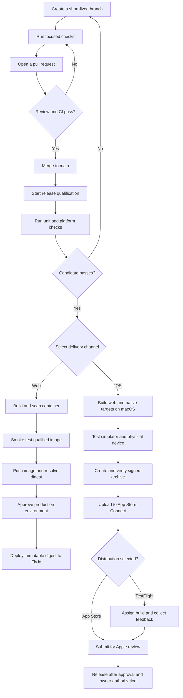

# Web and iOS CI/CD Pipeline

This repository demonstrates the delivery controls used for a web and iOS
application. The application source is private. The public application is
available at [fuppo.app](https://fuppo.app).

## Purpose

Use this repository to review or adapt the pipeline design without exposing the
production application, credentials, signing identities, device records, or
release history.

The repository includes:

- Cross-platform Node.js CI for Ubuntu and Windows.
- Container build, vulnerability scan, and runtime smoke-test steps.
- A manual, approval-gated Fly.io deployment workflow.
- Release guards for source identity and immutable image deployment.
- Testable iOS build and qualification planning utilities.

The repository does not include the application source, native Xcode project,
deployment credentials, or real browser and touch-test adapters.

## Run Locally

Install Node.js 24 or later, then run:

```shell
npm ci --ignore-scripts
npm test
```

The test suite uses injected commands and synthetic results. It does not deploy,
publish commit statuses, run Xcode, or contact production services.

## GitHub Actions

| Workflow | Trigger | Purpose |
| --- | --- | --- |
| CI | Pull requests, pushes to `main`, or manual dispatch | Runs the Node.js 24 test suite on Ubuntu and Windows. |
| Container qualification | Manual dispatch or CD workflow | Builds the image, verifies Trivy, scans for fixable High and Critical vulnerabilities, and smoke tests the container. |
| CD | Manual dispatch | Tests and qualifies a release candidate. Deployment is disabled unless the operator explicitly requests it. |
| Dependabot | Weekly | Proposes npm and GitHub Actions updates after a seven-day cooldown. |

CI is ready to run in this repository. Container qualification and CD require a
real `application/` directory and build adapter.

## Deployment Controls

The CD workflow deploys only when every control passes:

1. The workflow runs from `main`.
2. Unit, container security, and runtime checks pass.
3. The `FLY_APP_NAME` repository variable names the target application.
4. The operator enters the same application name when starting the workflow.
5. The protected `production` environment approves the job.
6. The environment provides the `FLY_API_TOKEN` secret.

The workflow exports the qualified container, pushes that exact image, resolves
its registry digest, and deploys the digest. It does not rebuild the image after
qualification.

For this showcase, leave the `deploy` option off. Before enabling deployment in a
fork, replace the `example-app` placeholders in `fly.toml` and
`scripts/release.mjs`, add the application adapter, and review the environment
protection rules.

## Security Controls

- Workflows receive read-only repository permissions by default.
- Third-party Actions use full commit SHAs.
- Checkout steps do not persist Git credentials.
- The Trivy archive is version-pinned and checksum-verified.
- Deployment secrets are available only to the protected deployment job.
- Qualified image artifacts expire after one day.
- Release scripts reject dirty, non-`main`, or unsynchronized source trees.

## Delivery Flow

Website delivery and iOS distribution are independent. TestFlight distribution
is optional. Public App Store release remains a manual decision after Apple
approval.


