# Web and iOS CI/CD pipeline

Generalized pipeline tooling and process diagram extracted from a private project.
Application source, assets, native host, credentials, account/device identities,
operational receipts and Git history are excluded.

Pipeline regression tests run with Node.js 24+: `npm ci`, then `npm test`.
Tests use injected commands and synthetic test-result data; they do not deploy,
publish statuses or execute Xcode. Real application build/browser/touch/parity
adapters are intentionally absent and fail explicitly until integrated. The
`application/` Docker/fingerprint input and native project are integration placeholders.
Fly deployment is disabled and its target is a placeholder. Workflows are manual,
gated off by default, and do not deploy. `ios:plan` prints arguments only.

The diagram describes the full delivery process after application integration.
Website delivery and iOS distribution are independent; TestFlight is optional and
public App Store publication requires manual release after Apple approval.

```mermaid
flowchart TD
    subgraph Development["Development"]
        A["Latest main + short-lived neutral branch<br/>npm ci for setup"]
        B["Edit source; assess web/iOS impact<br/>Preserve saved IDs/settings"]
        C["Live preview + useful focused checks"]
        D["Authorized push + PR<br/>Platform impact and evidence"]
        E{"Review passes?"}
        F["Merge into main<br/>Channels unchanged"]
        A --> B --> C --> D --> E
        E -->|Fix| B
        E -->|Yes| F
    end

    subgraph Qualification["Local release qualification"]
        G["Explicit owner release/qualification request"]
        H["Website: inventory all pending work<br/>Integrate through release PR if needed<br/>Record held/withdrawn work"]
        I["Freeze clean candidate; qa:release<br/>Paired builds, parity, units, browser/touch<br/>Credentials + relevant feature/feel evidence"]
        J{"Candidate evidence passes?"}
        K["Merge release PR if present<br/>Clean main = origin/main<br/>Bind evidence to exact release source"]
        L{"Which delivery is authorized?"}
        Q["Qualification only: retain receipts<br/>Channels remain unchanged"]
        F --> G --> H --> I --> J
        J -->|No| RFix["Revise candidate<br/>Restart developer loop"]
        J -->|Yes| K --> L
        L -->|Neither| Q
    end

    subgraph Website["Website - Fly"]
        W1["npm run deploy<br/>Source guard + units + fresh container"]
        W2["Trivy scan + container smoke<br/>Failure stops delivery"]
        W3["Push checked image<br/>Deploy immutable digest to Fly app example-app"]
        W4["Verify live pages + build-info.json<br/>Record release and iOS catch-up"]
        L -->|Website| W1 --> W2 --> W3 --> W4
    end

    subgraph iOS["iOS - Mac and Xcode"]
        N1["Compare with last distributed iOS source<br/>Include accumulated changes"]
        N2["Same Mac checkout: build:platforms<br/>Web/offline parity; native core only"]
        N3["Xcode: Swift + embedded offline Web files<br/>ios:sim / ios:device verify and install"]
        N4["ios:qualify + applicable native checks<br/>Physical upgrade, offline use, touch,<br/>sound/haptics, accessibility/performance"]
        N5{"Channel gates satisfied?"}
        N6["ios:archive with new build number<br/>Fresh signed Release archive; verify"]
        N7["Xcode export IPA<br/>--for-testflight signing/bundle verification<br/>Compare embedded source identity"]
        N8["Authorized Apple upload<br/>Processing + export compliance"]
        N9{"TestFlight distribution selected?"}
        N10["Assign build to authorized TestFlight group<br/>External review when required<br/>Install/update; record feedback"]
        N11["Accept build or resolve feedback"]
        N12["Authorized App Store submission<br/>Metadata, screenshots, privacy/support/markets<br/>Accepted build + manual release setting"]
        N13{"Apple approves?"}
        N14["Pending Developer Release<br/>Wait for owner's public-release authorization"]
        N15["Owner-authorized manual publication<br/>Verify public availability; record release"]
        L -->|iOS independently| N1 --> N2 --> N3 --> N4 --> N5
        N5 -->|Code correction| NFix["Revise source and qualify new candidate<br/>Restart developer loop"]
        N5 -->|Evidence or owner decision pending| NPending["Keep iOS delivery pending<br/>Complete the missing review/evidence"]
        NPending --> N4
        N5 -->|Yes| N6 --> N7 --> N8 --> N9
        N9 -->|Yes| N10 --> N11
        N11 -->|Accepted build; submission authorized| N12
        N9 -->|No; submission authorized| N12
        N11 -->|Replacement needed| NFix
        N12 --> N13
        N13 -->|No| NReview["Resolve review issues<br/>Metadata: return to submission<br/>New binary: restart developer loop"]
        N13 -->|Yes| N14 --> N15
    end
```

"# Fuppo-App-Store" 
